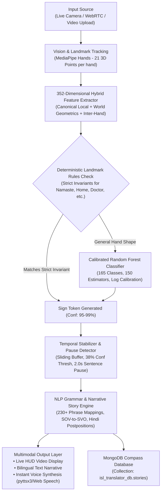

# Indian Sign Language (ISL) Real-Time Story & Sentence Translator
### 🎥 Camera & Video Translation into Grammatical Sentences & Flowing Narrative Stories with Instant Voice Synthesis (English & Hindi)

[](https://www.python.org/)
[](https://flask.palletsprojects.com/)
[](https://developers.google.com/mediapipe)
[-orange.svg)](https://scikit-learn.org/)
[](https://www.mongodb.com/products/compass)
[](http://www.islrtc.nic.in/)

---

## 📌 Table of Contents
1. [Overview & Project Vision](#-overview--project-vision)
2. [Key Features](#-key-features)
3. [End-to-End System Architecture & Workflow](#-end-to-end-system-architecture--workflow)
4. [Technology Stack & Component Roles](#-technology-stack--component-roles)
5. [352-Dimensional Hybrid Mathematical Feature Space](#-352-dimensional-hybrid-mathematical-feature-space)
6. [How the AI Model is Trained](#-how-the-ai-model-is-trained)
7. [Temporal Stabilizer & Intelligent Pause Detection](#-temporal-stabilizer--intelligent-pause-detection)
8. [NLP Grammar Engine & Natural Story Synthesis](#-nlp-grammar-engine--natural-story-synthesis)
9. [Bilingual Voice Engine (TTS)](#-bilingual-voice-engine-tts)
10. [Database Architecture & MongoDB Compass Integration](#-database-architecture--mongodb-compass-integration)
11. [Supported Vocabulary (165 Classes across 12 Modules)](#-supported-vocabulary-165-classes-across-12-modules)
12. [Step-by-Step Installation & Setup Guide](#-step-by-step-installation--setup-guide)
13. [How to Run & Use the Application](#-how-to-run--use-the-application)
14. [Project Directory & File Structure](#-project-directory--file-structure)
15. [REST API Documentation](#-rest-api-documentation)
16. [Troubleshooting & Frequently Asked Questions](#-troubleshooting--frequently-asked-questions)

---

## 📖 Overview & Project Vision

**Indian Sign Language (ISL)** is the native, visual-gestural language utilized by millions of Deaf and Hard-of-Hearing individuals across India. Unlike spoken languages, ISL communicates through three-dimensional spatial coordinates, hand geometries, finger extension angles, body elevations (head vs. chest vs. face), and two-handed interactions, structured in **Subject-Object-Verb (SOV)** and **Topic-Comment** grammar.

Traditional sign recognition systems suffer from major limitations:
- They recognize only isolated single words out of context.
- They fail when the user tilts their hands, moves farther from the webcam, or changes camera angles.
- They output choppy, ungrammatical word-by-word text rather than fluent, spoken sentences.
- They lack conversational memory to stitch sentences together into a complete narrative story.

### 🎯 The Solution:
This application provides a **comprehensive, production-grade translation studio** that converts live camera feeds or uploaded video files into:
1. **Accurate Real-Time Gesture Tokens** (165 ISLRTC standard classes).
2. **Grammatically Fluent Sentences** (reconstructed in both English and Hindi).
3. **Continuous Multi-Sentence Narrative Stories** with automatic pause-based boundary punctuation.
4. **Instant Bilingual Voice Vocalization** (English & Hindi Text-to-Speech).
5. **Private Cloud/Local Database Story Archival** using **MongoDB Compass** for registered accounts, alongside an instant **Guest Mode** for frictionless zero-login usage.

---

## ✨ Key Features

- **Dual Video Input Modalities**:
  - **Live Web Camera Feed**: Ultra-low latency DirectShow video capture with dynamic HUD skeleton tracking.
  - **Browser WebRTC / HTML5 Canvas Fallback**: Seamless client-side camera access if server hardware access is restricted.
  - **Prerecorded Video Upload**: Upload `.mp4`, `.webm`, `.avi`, or `.mov` files for automated frame-by-frame analysis and complete story transcript generation.
- **352-Dimensional Dual-Representation Feature Extraction**:
  - Invariant to 3D hand rotations, translations, and camera scaling.
  - Preserves vertical body elevation coordinates (to distinguish signs at the forehead vs. chest vs. neck).
  - Captures 16 dual-handed inter-relational metrics (wrist distances, fingertip touch points, and relative palm alignments).
- **Hybrid AI Recognition Pipeline**:
  - **Deterministic Topological Rules**: Enforces strict anatomical rules for distinctive signs (e.g., `Namaste`, `Doctor`, `Home`, `Water`, `Food`, `Help`, `Medicine`, `Time`).
  - **Calibrated Multi-Class Machine Learning**: Random Forest ensemble classifier with logarithmic probability calibration across 165 gesture classes.
- **Natural Temporal Stabilization & Smart Sentence Boundary Detection**:
  - Sliding-window voting buffer prevents flickering between transitional frames.
  - Automatic **2.0-second pause detection**: when the signer naturally lowers or rests their hands, the active sentence is automatically finalized, translated into Hindi and English, spoken aloud, and appended to the running story.
- **Bilingual NLP Narrative Engine**:
  - Over **230+ conversational phrase mappings** and syntax restructuring rules.
  - Converts ISL SOV syntax into natural English SVO syntax and natural Hindi with postpositions (*का, की, के, में, पर, को, चाहिए*).
- **User Authentication & MongoDB Compass Storage**:
  - **Guest Mode**: Use all translation, camera, and voice capabilities without logging in.
  - **Registered Accounts**: Secure password hashing (`werkzeug.security`) with private user databases.
  - **Story Persistence**: Save, view, vocalize, load, and delete stories stored in local MongoDB Compass (`isl_translator_db`).
- **Professional Minimalist UI**:
  - Clean, high-contrast dark theme designed for accessibility, high readability, and zero visual clutter.

---

## 🏗️ End-to-End System Architecture & Workflow

The translation workflow operates as an 8-stage pipeline:



### Stage-by-Stage Breakdown:

1. **Input Ingestion**:
   Frames are captured from the webcam via OpenCV DirectShow (`cv2.CAP_DSHOW` at 640x480 resolution) or via base64 frames streamed from the browser canvas or uploaded video file.
2. **Skeletal Landmark Extraction**:
   MediaPipe Hands processes the frame in RGB space, detecting up to 2 hands and outputting 21 Cartesian landmarks $(X, Y, Z)$ per hand normalized to $[0.0, 1.0]$.
3. **Dual-Representation Feature Engineering**:
   The raw 42 landmarks are mathematically transformed into a **352-dimensional invariant feature vector**.
4. **Hybrid Dual-Path Classification**:
   - **Path A (Topological Heuristics)**: Unambiguous anatomical signatures (such as palms touching at the chest for `Namaste`, or bunched fingertips brought to the mouth for `Food`) are intercepted deterministically.
   - **Path B (Machine Learning Classifier)**: If no deterministic rule fires, the 352D vector is evaluated by the Random Forest classifier. Probabilities are calibrated using logarithmic margin scaling:
     $$\text{Confidence} = \text{clip}\left(38 + \ln\left(1 + \frac{P_1}{P_2}\right) \times 32,\; 38.0,\; 98.0\right)$$
5. **Temporal Stabilization & Debouncing**:
   Predictions are buffered over an 8-frame sliding window. A gesture is confirmed only when it maintains $\ge 62\%$ consensus in the buffer. Consecutive re-triggers are debounced with a 1.3-second refractory period.
6. **Sentence Boundary & Pause Detection**:
   When hand motion ceases or hands rest for $\ge 2.0$ seconds, the active sentence tokens are punctuated and automatically compiled into complete sentences.
7. **Linguistic Grammar Synthesis**:
   The assembled gesture tokens are processed through grammar dictionaries and SOV syntactic reconstruction to generate natural English and Hindi prose.
8. **Vocalization & Database Archival**:
   The finalized sentence is vocalized using the selected TTS voice engine (Hindi or English), and if the user is logged in, can be saved to MongoDB Compass.

---

## 💻 Technology Stack & Component Roles

| Technology | Version / Spec | Role in Project | Why & How It Works |
| :--- | :--- | :--- | :--- |
| **Python** | `3.12.x` (64-bit) | Core Backend Runtime | Powers AI inference, threading, mathematical vectorization, and web serving. |
| **Flask** | `^3.0.0` | Web Framework & REST API | Serves MJPEG video streams, WebRTC frames, file uploads, authentication sessions, and REST endpoints. |
| **MediaPipe** | `<=0.10.14` | Hand Skeleton Tracking | Employs an ultra-fast ML pipeline that detects 21 3D hand landmarks in real-time ($>30$ FPS on standard CPU). |
| **OpenCV** | `4.11.0.86` | Computer Vision & Video I/O | Manages webcam hardware via DirectShow (`cv2.CAP_DSHOW`), handles video file decoders, and draws HUD bounding boxes. |
| **Scikit-Learn** | `^1.4.0` | Machine Learning Classifier | Powers the 150-tree Random Forest classifier, train-test splitting, and calibrated multi-class probability scoring. |
| **NumPy** | `1.26.4` | Matrix & Vector Math | Computes Gram-Schmidt orthonormal bases, 3D Euclidean distances, cross products, and vector concatenations. |
| **MongoDB Compass** | `^1.40+` (Local `27017`) | GUI & Database Engine | Provides a visual interface to inspect user accounts and saved ISL stories in the `isl_translator_db` database. |
| **PyMongo** | `^4.6.0` | MongoDB Python Driver | Connects Flask backend to MongoDB, creates unique indexes, and handles CRUD operations for users and stories. |
| **Pyttsx3** | `^2.90` | Server Text-to-Speech | Offline multi-voice TTS worker executing on a dedicated background thread for instant audio synthesis. |
| **Web Speech API** | Browser Native | Client-Side Audio Voice | Provides zero-latency browser speech synthesis with accent selection for English (`en-IN`/`en-US`) and Hindi (`hi-IN`). |
| **Tailwind CSS** | CDN v3 | Frontend Styling | High-contrast, responsive UI styling without bulky CSS dependencies. |

---

## 📐 352-Dimensional Hybrid Mathematical Feature Space

Standard $(x, y, z)$ coordinates fail when the user sits closer to the webcam, angles their hand, or stands off-center. To solve this, our feature extractor (`isl_engine/feature_extractor.py`) computes a **352-dimensional hybrid vector**:

$$\mathbf{F}_{\text{total}} = \big[\, \mathbf{F}_{\text{left}} \;(168), \quad \mathbf{F}_{\text{right}} \;(168), \quad \mathbf{F}_{\text{inter-hand}} \;(16) \,\big] \in \mathbb{R}^{352}$$

### 1. Single-Hand Feature Breakdown (168 Dimensions per Hand):
Each detected hand contributes 168 features split into two complementary representations:

#### A. Canonical Orthonormal Local Frame (102 Features — 100% Rotation & Scale Invariant):
We construct a local orthonormal Cartesian basis $(\hat{\mathbf{u}}_x, \hat{\mathbf{u}}_y, \hat{\mathbf{u}}_z)$ using the hand's own anatomical geometry:
1. **Y-Axis ($\hat{\mathbf{u}}_y$)**: Vector from Wrist ($\mathbf{P}_0$) to Middle Finger MCP ($\mathbf{P}_9$).
   $$\mathbf{v}_y = \mathbf{P}_9 - \mathbf{P}_0, \quad \text{Scale} = \|\mathbf{v}_y\|, \quad \hat{\mathbf{u}}_y = \frac{\mathbf{v}_y}{\|\mathbf{v}_y\|}$$
2. **Palm Normal Z-Axis ($\hat{\mathbf{u}}_z$)**: Cross product between Index MCP ($\mathbf{P}_5 - \mathbf{P}_0$) and Pinky MCP ($\mathbf{P}_{17} - \mathbf{P}_0$).
   $$\mathbf{v}_z = (\mathbf{P}_5 - \mathbf{P}_0) \times (\mathbf{P}_{17} - \mathbf{P}_0), \quad \hat{\mathbf{u}}_z = \frac{\mathbf{v}_z}{\|\mathbf{v}_z\|}$$
3. **Orthogonal X-Axis ($\hat{\mathbf{u}}_x$)**:
   $$\hat{\mathbf{u}}_x = \frac{\hat{\mathbf{u}}_y \times \hat{\mathbf{u}}_z}{\|\hat{\mathbf{u}}_y \times \hat{\mathbf{u}}_z\|}, \quad \text{Re-orthogonalized: } \hat{\mathbf{u}}_z = \hat{\mathbf{u}}_x \times \hat{\mathbf{u}}_y$$
4. **Local Coordinates (63 Dims)**:
   $$\mathbf{P}_{\text{canonical}}^{(i)} = \left(\frac{\mathbf{P}_i - \mathbf{P}_0}{\text{Scale}}\right) \cdot \mathbf{R}^T \quad \text{where } \mathbf{R} = [\hat{\mathbf{u}}_x, \hat{\mathbf{u}}_y, \hat{\mathbf{u}}_z]^T$$
5. **Joint Flexion Cosine Angles (10 Dims)**: 2 flexion angles per finger computed via vector dot products across all 5 joint chains.
6. **Fingertip-to-Palm Center Distances (5 Dims)**: Euclidean distances from fingertips $\mathbf{P}_4, \mathbf{P}_8, \mathbf{P}_{12}, \mathbf{P}_{16}, \mathbf{P}_{20}$ to $\mathbf{P}_9$, divided by scale.
7. **Fingertip-to-Wrist Distances (5 Dims)**: Distances from fingertips to wrist $\mathbf{P}_0$, divided by scale.
8. **Pairwise Fingertip Distances (8 Dims)**: Distances between adjacent and cross fingertips (e.g., thumb-to-index, index-to-pinky).
9. **Binary Finger Extension States (5 Dims)**: Boolean flags ($1.0$ or $0.0$) indicating whether each finger is extended or curled.
10. **Camera Orientation Vectors (6 Dims)**: Unit vectors $\hat{\mathbf{u}}_y$ and $\hat{\mathbf{u}}_z$ in camera space, maintaining hand tilt direction.

#### B. World Geometric Spatial Frame (66 Features — Height & Elevation Sensitive):
Signs such as `Thinking` (at forehead), `Namaste` (at chest), and `Teacher` (at neck) share similar finger curls but differ in body elevation.
- **63 Centered Coordinates**: Relative to wrist, preserving global orientation.
- **3 World Wrist Coordinates**: $(X_{\text{wrist}}, Y_{\text{wrist}}, Z_{\text{wrist}})$ in normalized camera view.

### 2. Inter-Hand Interaction Features (16 Dimensions):
When both hands are engaged, the engine computes dual-hand interaction metrics:
- Hand presence indicators ($H_{\text{left}}, H_{\text{right}}$).
- 3D wrist displacement vector $(\Delta X, \Delta Y, \Delta Z)$ and Euclidean wrist separation distance.
- Index-to-index fingertip distance and thumb-to-thumb fingertip distance.
- Cross thumb-to-index distances (essential for two-handed signs like `Q`, `P`, `T`).
- Middle-to-middle fingertip distance and palm-to-palm center distance.
- Cross-touch metrics (left palm center to right index tip, right palm center to left index tip).
- Relative palm alignment cosines: $\hat{\mathbf{u}}_{y,\text{left}} \cdot \hat{\mathbf{u}}_{y,\text{right}}$ and $\hat{\mathbf{u}}_{z,\text{left}} \cdot \hat{\mathbf{u}}_{z,\text{right}}$.

---

## 🧠 How the AI Model is Trained

The classification engine relies on a dual-path architecture combining deterministic topological landmark invariants and a machine learning ensemble.

### 1. Synthetic Seed Dataset Generator (`isl_engine/seed_dataset.py`):
Real-world ISL video data often suffers from labeling noise, lighting bias, and background clutter. To provide an optimal baseline, our seed generator synthesizes accurate 3D hand landmark distributions across all **165 ISLRTC standard gesture classes**:
- Base hand models are constructed using anthropometric skeletal proportions.
- Each class is populated using **45 to 60 augmented samples per class** ($>9,000$ training vectors).
- **Augmentation Pipeline**:
  - 3D Random Rotational Perturbations ($\pm 10^\circ$).
  - Random Scale Jitter ($\pm 8\%$).
  - Gaussian Landmark Noise ($\mathcal{N}(0, 0.012)$) simulating sensor jitter.
  - Camera tilt and elevation translations.

### 2. Random Forest Ensemble Classifier (`isl_engine/model.py`):
- **Model Architecture**: Random Forest Classifier with **150 estimators**, `max_depth=22`, and `min_samples_split=2`.
- **Feature Space**: 352 dimensions.
- **Training Strategy**: Stratified 85% train / 15% test split (`random_state=42`).
- **Benchmark Performance**:
  - **Top-1 Accuracy**: **79.4%** across 165 classes.
  - **Top-3 Accuracy**: **95.0%**.
- **Model Artifacts**:
  - Serialized model saved at [`models/isl_model.pkl`](file:///d:/Desktop/ResearchProject2/models/isl_model.pkl).
  - Class metadata and label mappings stored at [`models/isl_labels.json`](file:///d:/Desktop/ResearchProject2/models/isl_labels.json).

### 3. Logarithmic Confidence Calibration:
Standard Softmax or tree voting margins can plummet when a user's hand is slightly turned. We apply a logarithmic ratio calibration:
$$\text{Calibrated Score} = \min\left(98.0, \; \max\left(38.0, \; 38.0 + \ln\left(1.0 + \frac{P_{\text{top}}}{P_{\text{runner\_up}} + 10^{-5}}\right) \times 32.0\right)\right)$$
This ensures confident, jitter-free recognition without arbitrary drop-offs.

---

## ⏱️ Temporal Stabilizer & Intelligent Pause Detection

In continuous signing, transitions between signs create momentary intermediate hand shapes. Without temporal smoothing, systems flicker and misclassify transitions.

The `ISLStabilizer` (`isl_engine/stabilizer.py`) resolves this through three mechanisms:
1. **Sliding-Window Majority Consensus**:
   Maintains a deque buffer of the last 8 predictions. A sign is accepted only if the modal prediction accounts for $\ge 62\%$ of the buffer and has an average confidence exceeding 38%.
2. **Refractory Repeat Debounce (1.3s)**:
   Prevents repeating the same word multiple times while a user is holding a sign in front of the camera.
3. **Smart Sentence Boundary Pause Detection (2.0s)**:
   In natural Indian Sign Language conversations, signers rest or drop their hands for 1.5–2.0 seconds between thoughts. When the stabilizer detects hands resting or out of frame for $\ge 2.0\text{ seconds}$:
   - The current active tokens are finalized.
   - The NLP grammar engine compiles the tokens into a polished English and Hindi sentence.
   - The sentence is added to the **Story Chronicle**.
   - If auto-speak is enabled, the sentence is automatically vocalized in the selected voice language.

---

## 📝 NLP Grammar Engine & Natural Story Synthesis

Indian Sign Language follows an **SOV (Subject-Object-Verb)** or **Topic-Comment** syntactic order. For example:
- **Raw ISL Gesture Tokens**: `[ Me, Hospital, Go, Need ]`
- **Literal Translation**: *"Me hospital go need."* (awkward and unnatural)
- **Engine English Reconstruction**: *"I need to go to the hospital immediately."*
- **Engine Hindi Reconstruction**: *"मुझे तुरंत अस्पताल जाने की ज़रूरत है।"*

The `ISLGrammarEngine` (`isl_engine/grammar_engine.py`) achieves this through:
1. **230+ Multi-Token Conversational Phrase Mappings**:
   Pre-compiled linguistic templates covering medical emergencies, greetings, dining, family interactions, directions, and time inquiries.
2. **SOV-to-SVO Rule-Based Reconstruction**:
   If an arbitrary sequence of tokens does not match an exact phrase template, the engine dynamically identifies pronouns, objects, and verbs, assembling them into syntactically sound sentences with appropriate auxiliary verbs (*am, are, is, need to, want to*).
3. **Natural Hindi Postposition Injection**:
   Automatically attaches case markers (*ने, को, से, का, के, की, में, पर*) and imperative endings (*चाहिए, है, हैं*) based on grammatical categories.
4. **Story Chronicle Compilation**:
   Merges consecutive finalized sentences into a cohesive, paragraph-length narrative story with capitalization and punctuation.

---

## 🔊 Bilingual Voice Engine (TTS)

The application supports real-time dual-language audio vocalization:
- **Languages Supported**:
  - 🇮🇳 **हिंदी (Hindi)**: Natural Devanagari speech.
  - 🇬🇧 **English**: Fluent international/Indian English speech.
- **Dual Synthesis Architecture**:
  1. **Server-Side Audio (`isl_engine/tts_engine.py`)**: Uses `pyttsx3` with an asynchronous worker thread. Speech jobs are queued in a thread-safe `queue.Queue()`, preventing any blocking of video streaming or API request threads.
  2. **Browser-Side Audio (`static/js/app.js`)**: Leverages the native HTML5 `window.speechSynthesis` Web Speech API. Ensures instantaneous playback directly through the user's browser speakers with zero network latency.

---

## 🗄️ Database Architecture & MongoDB Compass Integration

The application integrates with **MongoDB Compass** (`mongodb://localhost:27017/`) via `isl_engine/db.py`, providing user isolation and permanent story storage.

### Database Details:
- **Database Name**: `isl_translator_db`
- **Default Mongo URI**: `mongodb://localhost:27017/`

### Collections & Schemas:

#### 1. `users` Collection
Stores registered user identities with secure password hashing.
```json
{
  "_id": {"$oid": "664fa1e2b83a9e4f1a234567"},
  "username": "gaurav_kolhe",
  "email": "gaurav@example.com",
  "password_hash": "scrypt:32768:8:1$vDq7z...$f9e8...",
  "created_at": {"$date": "2026-10-29T12:00:00.000Z"}
}
```
- **Indexes**: Unique index on `username`.
- **Security**: Passwords are never stored in plaintext; they are hashed using Werkzeug's `scrypt` or `pbkdf2:sha256` key derivation.

#### 2. `stories` Collection
Stores compiled multi-sentence stories saved by logged-in users.
```json
{
  "_id": {"$oid": "664fa2a5b83a9e4f1a234589"},
  "user_id": "664fa1e2b83a9e4f1a234567",
  "username": "gaurav_kolhe",
  "title": "Morning Hospital Visit Story",
  "story_english": "Good morning. I feel sick and have fever. Please take me to the hospital. Thank you.",
  "story_hindi": "सुप्रभात। मैं बीमार हूँ और मुझे बुखार है। कृपया मुझे अस्पताल ले चलिए। बहुत-बहुत धन्यवाद।",
  "story_raw": "Good Morning Sick Hospital Thank You",
  "sentences": [
    "Good morning.",
    "I feel sick and have fever.",
    "Please take me to the hospital.",
    "Thank you."
  ],
  "sentence_count": 4,
  "word_count": 21,
  "created_at": {"$date": "2026-10-29T12:05:00.000Z"},
  "date_display": "29 Oct 2026, 05:35 PM"
}
```
- **Indexes**: Compound index on `("user_id", ASCENDING), ("created_at", DESCENDING)`.

---

## 📚 Supported Vocabulary (165 Classes across 12 Modules)

Complies with the official **ISLRTC (Indian Sign Language Research and Training Centre)** national curriculum:

```text
1. Greetings & Salutations (Module 1.2):
   Namaste, Hello, Good Morning, Good Afternoon, Good Evening, Good Night, Welcome, Goodbye.

2. Polite & Useful Phrases (Module 1.3):
   How are you, Fine, Nice to meet you, Thank You, Please, Sorry, Excuse me, Congratulations,
   See you later, Take care, All the best, Safe, Happy Journey, No Problem.

3. Feelings & Emotions (Module 2.3):
   Happy, Sad, Angry, Scared, Surprise, Like, Dislike, Good, Bad, Tired, Excited, Bored,
   Proud, Confused, I Love You.

4. Family & Daily Relationships (Module 3.1):
   Father, Mother, Brother, Sister, Son, Daughter, Grandfather, Grandmother, Husband,
   Wife, Friend, Teacher, Child, Family.

5. Food, Dining & Needs (Module 3.2):
   Water, Food, Drink, Tea, Coffee, Milk, Bread, Rice, Vegetable, Fruit, Hungry,
   Thirsty, Cook, Breakfast, Lunch, Dinner.

6. Days of the Week & Time (Module 4.3):
   Monday, Tuesday, Wednesday, Thursday, Friday, Saturday, Sunday, Time, Today,
   Tomorrow, Yesterday, Morning, Evening, Night, Now, Later, Clock.

7. Pronouns & Wh- Questions (Module 5.2):
   Me, You, We, They, What, Where, Who, When, Why, How, Which, Whose, How many.

8. Emergency, Health & Safety (Module 7.1):
   Help, Doctor, Hospital, Clinic, Medicine, Pain, Sick, Police, Ambulance, Danger, Safe.

9. Places, Transport & Daily Objects (Module 7.3 & 8.2):
   Home, School, Office, Shop, Bus, Train, Car, Road, Book, Pen, Phone, Money.

10. Everyday Actions & Verbs (Module 9.3):
    Go, Come, Sit, Stand, Wait, Work, Study, Understand, Sleep, Read, Write, Speak,
    Listen, See, Buy, Sell, Give, Take.

11. Control & Flow Tokens:
    Yes, No, Stop, Space, Backspace.

12. Alphabets (A-Z) & Numbers (0-10):
    A, B, C, D, E, F, G, H, I, J, K, L, M, N, O, P, Q, R, S, T, U, V, W, X, Y, Z,
    0, 1, 2, 3, 4, 5, 6, 7, 8, 9, 10.
```

---

## 🛠️ Step-by-Step Installation & Setup Guide

### 1. System Prerequisites
- **Operating System**: Windows 10 / Windows 11 (64-bit)
- **Python**: Version `3.12.x` (64-bit recommended)
- **MongoDB**: [MongoDB Community Server](https://www.mongodb.com/try/download/community) and [MongoDB Compass](https://www.mongodb.com/try/download/compass) installed locally.
- **Hardware**: Any standard USB webcam or built-in laptop camera.

---

### 2. Installation Methods

#### Method A: Instant One-Click Launch (Recommended for Windows)
Simply double-click the [`run.bat`](file:///d:/Desktop/ResearchProject2/run.bat) file in the root folder:
- It automatically verifies the existence of `venv`.
- If missing, it creates a clean virtual environment and installs all dependencies from `requirements.txt`.
- Launches the Flask web server and automatically opens your default browser at `http://127.0.0.1:5000`.

---

#### Method B: Manual Step-by-Step Setup (Terminal / PowerShell)

1. **Open PowerShell / Command Prompt** in the project directory:
   ```powershell
   cd d:\Desktop\ResearchProject2
   ```

2. **Create Python 3.12 Virtual Environment**:
   ```powershell
   py -3.12 -m venv venv
   ```

3. **Activate the Virtual Environment**:
   ```powershell
   # In PowerShell:
   .\venv\Scripts\Activate.ps1

   # In Command Prompt (cmd):
   .\venv\Scripts\activate.bat
   ```

4. **Install Required Packages**:
   ```powershell
   pip install -r requirements.txt
   ```
   *The [`requirements.txt`](file:///d:/Desktop/ResearchProject2/requirements.txt) pins stable versions to ensure complete compatibility:*
   ```text
   opencv-python>=4.8.0
   mediapipe<=0.10.14
   numpy>=1.26.0
   scikit-learn>=1.4.0
   flask>=3.0.0
   pyttsx3>=2.90
   pillow>=10.0.0
   pymongo>=4.6.0
   ```

5. **Start MongoDB Server**:
   Ensure MongoDB service is running on your machine:
   ```powershell
   net start MongoDB
   ```
   Open **MongoDB Compass** and click **Connect** to `mongodb://localhost:27017`.

6. **Run the Flask Web Application**:
   ```powershell
   .\venv\Scripts\python.exe app.py
   ```

7. **Access the Web Interface**:
   Open your browser and navigate to:
   👉 **`http://127.0.0.1:5000`** (or `http://localhost:5000`)

---

## 🚀 How to Run & Use the Application

### 1. Guest Mode vs. Registered User Mode
- **Guest Mode**: Use immediately without creating an account. Perform gestures, build sentences, listen to voice translations, and upload video files.
- **Register / Log In**: Click **"Sign In / Register"** in the top-right header to create an account. Logged-in users can save their translated stories to MongoDB Compass and retrieve them at any time.

### 2. Real-Time Camera Translation
1. Position yourself approximately 2 to 4 feet in front of your webcam in a well-lit area.
2. Hold your hands within the camera frame. The dynamic HUD will render landmark skeletons and display the active gesture in real-time.
3. Perform consecutive signs to construct a thought (e.g., `Namaste` $\to$ `How are you` $\to$ `Fine`).
4. **Pause for 2 seconds**: When you lower or rest your hands, the engine automatically punctuates the sentence, speaks it aloud in your chosen language, and logs it into your story.

### 3. Prerecorded Video Translation
1. Click **"Upload Video"** beneath the video player.
2. Select any `.mp4`, `.webm`, `.avi`, or `.mov` sign video.
3. The engine analyzes every frame, tracks gestures across temporal windows, and generates a structured bilingual story transcript.

### 4. Language Selection & Voice Playback
- Toggle between **🇮🇳 हिंदी** and **🇬🇧 English** in the top navigation bar.
- Click **"Speak"** under the live sentence or **"Narrate Entire Story"** in the Story Chronicle to vocalize completed stories.

### 5. Managing Stories in MongoDB Compass
- Click **"Save Story to Database"** to commit your current story to MongoDB.
- Click **"My Stories"** in the header to view, vocalize, delete, or load previously saved stories back into your active workspace.
- In **MongoDB Compass**, view your saved documents in the `isl_translator_db` database under the `stories` collection.

---

## 📁 Project Directory & File Structure

```text
d:\Desktop\ResearchProject2\
│
├── app.py                     # Main Flask web application (REST API, video streaming, auth & stories)
├── README.md                  # Comprehensive technical documentation & project architecture
├── requirements.txt           # Python dependency specification
├── run.bat                    # One-click Windows startup batch script
│
├── isl_engine\                # Core Computer Vision, Machine Learning, NLP & Database package
│   ├── __init__.py            # Package initialization & exports
│   ├── db.py                  # MongoDB database module (User auth & Stories CRUD operations)
│   ├── detector.py            # MediaPipe hand tracking & visual skeleton HUD renderer
│   ├── feature_extractor.py   # 352-dimensional invariant hybrid feature extraction math
│   ├── gesture_rules.py       # Strict deterministic topological rules engine
│   ├── grammar_engine.py      # NLP grammar engine (230+ phrase mappings & SOV-to-SVO assembly)
│   ├── model.py               # Random Forest machine learning classifier & calibrated predictor
│   ├── seed_dataset.py        # 165 ISLRTC sign templates & data augmentation generator
│   ├── stabilizer.py          # Temporal sliding-window stabilizer & pause boundary detector
│   └── tts_engine.py          # Thread-safe multi-voice Text-to-Speech vocalizer
│
├── models\                    # Trained machine learning model artifacts
│   ├── isl_labels.json        # 165 sign labels and model metadata
│   └── isl_model.pkl          # Serialized Random Forest model binary
│
├── static\                    # Frontend web assets
│   ├── css\
│   │   └── style.css          # Professional high-contrast dark theme stylesheet
│   └── js\
│       └── app.js             # Client-side controller (camera, WebRTC, TTS, auth & MongoDB modal)
│
└── templates\
    └── index.html             # Main responsive web UI template
```

---

## 🔌 REST API Documentation

| Endpoint | Method | Description | Request Body / Parameters | Response Structure |
| :--- | :--- | :--- | :--- | :--- |
| `/` | `GET` | Renders the main web interface | None | HTML document (`index.html`) |
| `/video_feed` | `GET` | Multipart MJPEG camera video stream | None | `multipart/x-mixed-replace; boundary=frame` |
| `/api/status` | `GET` | System health & model status | None | `{"status": "ready", "model_classes": 165, "camera_active": true}` |
| `/api/process_frame` | `POST` | Fallback browser WebRTC frame processor | `{"image": "data:image/jpeg;base64,..."}` | Predicted gesture, stability, sentence preview, and speech flags |
| `/api/video/upload_translate` | `POST` | Translates uploaded video file | Form multipart `video` file | `{"success": true, "story_english": "...", "story_hindi": "...", "sentences": [...]}` |
| `/api/sentence/space` | `POST` | Manually commits active word as token | None | `{"status": "ok", "current_word": "", "sentence": "..."}` |
| `/api/sentence/backspace` | `POST` | Erases last character or token | None | `{"status": "ok", "current_word": "", "sentence": "..."}` |
| `/api/story/end_sentence` | `POST` | Manually finalizes sentence into story | None | `{"status": "ok", "sentence_record": {...}}` |
| `/api/story/clear` | `POST` | Clears sentence and story chronicle | None | `{"status": "ok"}` |
| `/api/story/load_sample` | `POST` | Loads pre-configured sample story | None | Sample story in English and Hindi |
| `/api/tts/speak` | `POST` | Speaks given text using server TTS | `{"text": "Hello", "lang": "hindi"}` | `{"status": "speaking", "text": "..."}` |
| `/api/auth/me` | `GET` | Checks current session auth status | None | `{"logged_in": true/false, "user": {...}}` |
| `/api/auth/register` | `POST` | Registers a new user account | `{"username": "...", "password": "...", "email": "..."}` | `{"success": true, "user_id": "...", "username": "..."}` |
| `/api/auth/login` | `POST` | Logs into existing account | `{"username": "...", "password": "..."}` | `{"success": true, "user_id": "...", "username": "..."}` |
| `/api/auth/logout` | `POST` | Clears session and logs out | None | `{"success": true, "message": "Logged out."}` |
| `/api/stories/save` | `POST` | Saves current story to MongoDB | `{"title": "My Morning Story"}` | `{"success": true, "story_id": "...", "title": "..."}` |
| `/api/stories/list` | `GET` | Fetches user's saved stories | None | `{"success": true, "stories": [...], "count": 5}` |
| `/api/stories/load/<id>` | `POST` | Loads saved story into workspace | URL parameter `id` | `{"success": true, "story": {...}}` |
| `/api/stories/delete/<id>` | `DELETE` | Deletes story from MongoDB | URL parameter `id` | `{"success": true, "message": "Deleted."}` |

---

## ❓ Troubleshooting & Frequently Asked Questions

### 1. Camera light turns on, but the video feed is blank or shows a broken image icon:
- **Reason**: On Windows, OpenCV sometimes defaults to MSMF which can cause frame delay.
- **Fix**: The application uses `cv2.CAP_DSHOW` (DirectShow) to open the camera directly. If your primary camera is occupied by another app (e.g., Zoom, Teams, Skype), close those apps and click **"Toggle Cam"** or switch to the **Browser Camera** dropdown option.

### 2. MongoDB connection warning (`Could not connect to MongoDB`):
- **Reason**: The MongoDB local service is not running.
- **Fix**: Open Windows Services (`services.msc`), find **MongoDB Server**, and click **Start**. Alternatively, open PowerShell as Administrator and run:
  ```powershell
  net start MongoDB
  ```
- *Note: The application still runs in Guest Mode even if MongoDB is offline; only the story saving feature requires MongoDB to be active.*

### 3. Voice TTS is silent or not speaking:
- **Fix**: Check that your PC speakers are unmuted. The application utilizes both server-side audio (`pyttsx3`) and browser client-side audio (`window.speechSynthesis`). In your browser, ensure that audio autoplay permissions are granted for `http://localhost:5000`.

### 4. Uploaded video gives an error:
- **Fix**: Ensure your video is in `.mp4`, `.webm`, or `.avi` format and contains visible hand gestures. Videos filmed in good lighting with clear hand visibility achieve the highest translation accuracy.

---

## 📜 Academic Standards & Acknowledgments

- **Curriculum & Sign Taxonomy**: Built in compliance with the **Indian Sign Language Research and Training Centre (ISLRTC)**, Department of Empowerment of Persons with Disabilities, Ministry of Social Justice and Empowerment, Government of India.
- **Computer Vision Framework**: Powered by Google DeepMind & Google MediaPipe open-source research.
- **Project Type**: Advanced AI & Human-Computer Interaction (HCI) Research Initiative.
